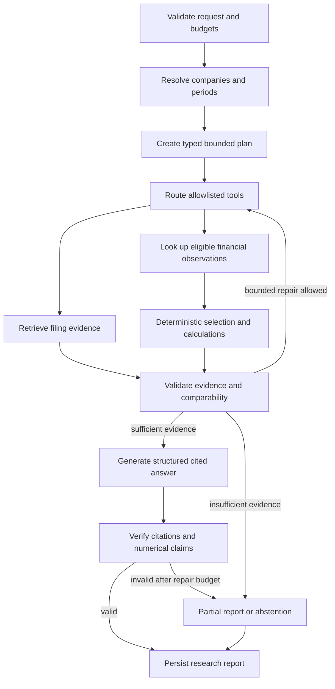

# AI and financial research architecture

Status: proposed. [ADR-004](../adr/ADR-004-retrieval.md), [ADR-005](../adr/ADR-005-research-orchestration.md), [ADR-006](../adr/ADR-006-financial-correctness.md), and [ADR-007](../adr/ADR-007-model-adapters.md) govern these components.

## Retrieval stages and gates

1. **Dense baseline:** embed versioned Gold chunks with one pinned model/dimension and search the matching index. Begin with exact similarity on a small corpus; add approximate indexes only after recall/latency measurement.
2. **Keyword baseline:** PostgreSQL full-text search over headings and content; preserve identifiers and financial terms that tokenization might lose. Evaluate exact ticker, concept, and phrase queries.
3. **Hybrid candidate:** fuse rank positions from dense and keyword retrieval with reciprocal rank fusion, deduplicate by evidence identity, and benchmark against both baselines. Tune constants and candidate sizes only on the development split.
4. **Reranker candidate:** score a bounded candidate set with a cross-encoder or provider adapter. Measure quality, p95 latency, and cost; enable only with demonstrated improvement.
5. **Context expansion:** add parent/neighbor context when useful, enforcing the same company, availability, dataset, and access filters. Tables retain headers/units and provenance.

Company, form, filing date, fiscal/measurement period, historical cutoff, snapshot, and access predicates apply to every candidate path. Run negative tests for filter leakage. Approximate pgvector searches combined with selective filters can under-return results; measure and use supported index/search settings or an exact filtered fallback. Never silently broaden scope to fill `K` results.

Embed indexes carry model ID, dimension, normalization/distance policy, chunking version, dataset version, and build status. A model or dimension change requires a new index and controlled activation. Query and document embeddings must match. Dense scores, full-text scores, reranker scores, and fusion ranks are different quantities; expose them separately in diagnostics.

## Stateful research workflow

Use one research agent with explicit graph nodes. The model can propose scope, plans, tool arguments, and prose; application code validates each before execution. Tools return typed data and explicit failure states. Ambiguous company or period resolution results in a clarification-required status or documented assumption, not an unannounced guess.

Graph state contains `run_id`, actor scope, request, resolved companies/periods, `as_of`, dataset/index versions, typed plan, tool results, evidence IDs, calculation IDs, errors, budgets consumed, and report draft. Record sanitized step events rather than hidden model reasoning. Checkpoints are versioned and persisted to PostgreSQL; incompatible state schema changes require migration or fail-safe termination.

Proposed initial operational limits, to validate in Phase 5: 12 tool invocations, 2 evidence-repair passes, at most 2 retries for transient tool/provider failures, and a 120-second research deadline. Token/cost limits are server-configured after provider selection. Deadline and cancellation checks happen before each expensive step. Retries consume shared budgets and do not reset them.

Checkpoint before/after side effects. Cache completed deterministic tool calls by validated arguments plus dataset/policy version. Persist provider request identifiers and usage; a crash after generation may leave an ambiguous billable result, so recovery cannot promise exactly-once provider execution. Record and cap repeat calls. A worker lease prevents concurrent execution of the same run; cancellation and exhausted budgets lead to explicit terminal states.

## Tool contracts

All tools use Pydantic-validated schemas, fixed implementations, bounded result sizes, and application authorization. Common context supplied by the server: actor scope, snapshot, cutoff, deadline, request ID, and policy version. Tool arguments cannot override that context.

| Tool | Input | Output and important failure modes |
| --- | --- | --- |
| `resolve_company` | Name, ticker, or CIK | CIK candidates with match rationale; `ambiguous_company` or `not_found` |
| `list_filings` | CIK, forms, date interval, page cursor | Filing records with source/availability metadata; no implicit current-only history |
| `search_filing_evidence` | Query, allowed company/period/form filters, bounded K | Ranked evidence IDs, excerpts, provenance, retrieval versions; `no_evidence` |
| `get_financial_facts` | CIK, approved concepts, measurement periods, unit/context requirements, selection mode | Candidate and selected observation IDs, policy explanation; `ambiguous_fact`, `incompatible_period`, `missing_context` |
| `get_financial_metric` | Approved metric ID, company, periods, selection mode | Versioned formula, selected inputs, decimal result and evidence; `unsupported_metric` or missing input |
| `calculate_financial_ratio` | Approved ratio ID and validated fact/result IDs | Decimal ratio with units and calculation record; rejects arbitrary expressions, zero denominator, incompatible inputs |
| `compare_financial_periods` | Compatible metric/fact IDs and comparison mode | Absolute/relative changes or percentage-point changes with period alignment; `non_comparable` |
| `resolve_citation` | Evidence ID in the current authorized snapshot | SEC URL, artifact hash, document/section/block/table locator, supported excerpt; `unresolvable_citation` |

Tools never accept arbitrary SQL, Python expressions, filesystem paths, URLs, shell commands, or provider credentials. Financial tools cannot select a number extracted by an LLM as authoritative without validated source observations.

## Deterministic finance

Candidate eligibility is checked before ranking: company, taxonomy/concept mapping, context, unit/currency, measurement interval, form, snapshot, and historical availability. Apply a versioned metric-specific concept priority only among semantically equivalent concepts. Ambiguity or conflicts outside policy produce a typed failure or qualified output.

- Revenue growth: `(current - prior) / prior × 100`, with compatible annual periods and currency; zero or nonpositive prior revenue produces an explicit undefined/not-meaningful policy result.
- Operating margin: `operating_income / revenue × 100`; denominator and numerator must share period, entity/context, currency, and reporting basis. Nonpositive revenue requires an explicit policy outcome.
- Margin change: subtract percentages and label **percentage points**; do not label it relative percentage growth.
- Capex trend: compare an explicitly named cash outflow concept such as payments to acquire property, plant, and equipment. State whether intangibles, acquisitions, or leases are excluded. Preserve source sign and apply a documented display sign policy.
- Standalone Q4 from annual minus nine-month YTD is allowed only when period endpoints, unit, scope, concept, and reporting versions reconcile. Mark it derived and retain both inputs. Instant values cannot be subtracted to invent duration flows.

Use decimal strings at JSON boundaries and Decimal arithmetic internally. Preserve input precision; round only under a recorded display policy. Do not currency-convert, combine segment and consolidated facts, or align different fiscal calendars silently. For cross-company annual comparisons, label each actual fiscal interval and any nonalignment.

## Evidence validation and synthesis

The model receives bounded, clearly delimited evidence with opaque IDs, plus verified calculation outputs. Retrieved instructions are data, not control messages. Synthesis must cite registry IDs rather than invent URLs. The citation resolver supplies final links and locators.

Validation checks: evidence exists in the selected snapshot, belongs to allowed scope, was available by cutoff, resolves to unchanged source bytes, and supports the intended type of claim. Numeric claims must match calculation or observation records. Narrative entailment needs a separate support assessment; an existing link alone does not prove the prose. Use deterministic rules where possible and a calibrated judge/human evaluation for semantic support. If final validation fails after a bounded repair, remove the unsupported claim or return a partial/abstained report.

## Research report contract

| Field | Intended content |
| --- | --- |
| `report_schema_version`, `run_id`, `status` | Version and terminal status: `completed`, `partial`, `abstained`, or `failed` |
| `scope` | Resolved CIKs, forms, actual period intervals, historical cutoff, assumptions |
| `summary`, `claims[]` | Claim IDs, text, narrative/numeric classification, evidence/calculation IDs, support status |
| `citations[]` | Evidence IDs, SEC URLs, artifact hashes, section/block/table locators, excerpts |
| `calculations[]` | Formula/policy versions, input observation IDs, values/units, decimal outputs, rounding and comparison semantics |
| `limitations[]`, `missing_evidence[]` | Conflicts, missing periods, unverified context, unsupported requests, abstention reasons |
| `provenance` | Dataset/index/model/prompt/parser versions, selection policy, timestamps |
| `usage` | Latency, tool counts, token counts, estimated/observed provider cost with pricing version |

Persist a validated report separately from mutable workflow state. The frontend must show partial/abstained states and cannot turn unsupported draft prose into a completed result. Provide calculation and source inspection alongside narrative findings.
