# Data architecture

Status: proposed. [ADR-003](../adr/ADR-003-data-pipeline.md) governs the pipeline; [data dictionary](../data-dictionary.md) defines records and invariants.

## Official source access

Use SEC Company Submissions and Company Facts under `data.sec.gov`, filing archives under `www.sec.gov/Archives/`, and official company metadata. Resolve older submissions through the additional files referenced by the submissions response; recent submissions alone are not a complete filing history. Preserve amendments as distinct accessions and explicitly choose whether the research includes them.

Before live ingestion, verify current guidance at the [SEC developer resources](https://www.sec.gov/about/developer-resources) and [EDGAR API documentation](https://www.sec.gov/search-filings/edgar-application-programming-interfaces). Configure an identifying organization/contact User-Agent using a real contact supplied through environment settings. Do not invent one.

Propose a conservative aggregate rate of at most 5 requests/second with low concurrency, below the SEC's documented 10 requests/second ceiling at design time; verify current policy in Phase 2 and obey any lower applicable limit. The limiter must coordinate across workers rather than multiply the rate per process. Honor `Retry-After`, exponential backoff with jitter, deadlines, response-size limits, and a finite retry budget. Treat repeated 403/429 responses as a reason to stop and investigate; never rotate identities to evade access controls.

Allowlist hosts and expected paths; validate redirects before following them. Use verified TLS and conditional requests where supported. Record status and safe response metadata, but do not persist request credentials. The SEC endpoints are public; model and cloud credentials are unrelated requirements.

## Ingestion and Bronze

```mermaid
flowchart LR
    Discover[Company and filing discovery] --> Work[Idempotent ingestion work record]
    Work --> Fetch[Bounded SEC HTTP fetch]
    Fetch --> Stage[Temporary download and checksum]
    Stage --> Bronze[Content-addressed immutable artifact]
    Bronze --> Manifest[Committed manifest with fetch metadata]
    Manifest --> Parse[Versioned parsing and normalization]
    Parse --> Silver[Silver dataset and quality events]
    Silver --> Build[Gold builder and integrity checks]
    Build --> Publish[Publish complete snapshot]
    Publish --> Serving[PostgreSQL serving projections]
    Publish --> Index[Derived search and vector indexes]
```

Artifact identity is SHA-256 of stored source bytes. A store entry such as `bronze/sha256/<prefix>/<hash>` is never overwritten. A fetch manifest records URL, source type, CIK/accession where applicable, fetch time, content type, byte count, HTTP status, validators, hash, and ingestion run. JSON and HTML are stored before normalization. Store returned payload bytes consistently after HTTP content decoding and record that convention; checksum verification refers to those exact stored bytes.

SEC JSON endpoints can change over time. A different response creates a new immutable artifact and manifest. Identical bytes may share an artifact, but every observation of the source may have a distinct fetch manifest. Failed attempts remain status records and cannot masquerade as successful artifacts.

Idempotency keys include source identity and fetch policy; successful work can reuse a manifest only when refresh semantics permit. Stage a complete object, compute and verify its checksum, atomically publish it, then commit the manifest. A crash between object and manifest creation leaves an unreferenced object for reconciliation; never commit a success manifest referencing missing bytes. Support local atomic rename and object-store conditional creation through the same interface.

## Silver normalization

- **Company and filing catalog:** normalize CIK as a ten-digit string, retain ticker/name history, accession, form, filing date, acceptance timestamp when available, report date, fiscal-year-end metadata, and primary-document URL. Tickers are aliases, not stable keys.
- **Documents:** identify document roles; parse HTML with scripts/styles excluded, no external resource loading, bounded size/depth/time, and source locators retained. Do not execute filing content.
- **Sections and blocks:** retain heading hierarchy, section labels, narrative paragraphs, lists, and tables. Store both normalized text and a mapping back to the raw artifact. Duplicate table-of-contents links and repeated headers require fixture-based handling.
- **Tables:** preserve row/column hierarchy, merged headers, footnotes, units, scale, sign conventions, and cell coordinates. A text rendering is useful for retrieval but cannot replace the structured representation. Parsing confidence and quality events travel with the table.
- **Financial observations:** retain taxonomy, concept, original lexical value, normalized decimal, unit, start/end or instant, accession, filing availability, SEC `fy`, `fp`, `frame`, and any verified context/dimensions. Preserve all later-reporting observations of the same period.
- **Quality:** distinguish hard integrity violations, quarantine-worthy ambiguity, and informational warnings. Do not turn parse failures or unknown dimensions into plausible values.

Company Facts does not supply complete raw XBRL contexts and dimensional detail in every record. Represent unavailable context explicitly. Do not label unknown context as consolidated merely because no dimensions were returned. The initial metric allowlist must validate known entity-wide concepts against fixtures and source filings; if context is insufficient, abstain or create a separately authorized work package for raw XBRL context extraction.

Observation `fy`/`fp` describe the filing's fiscal metadata and can refer to a filing that includes prior-year comparatives. The actual measurement dates govern period selection. `frame` is a source hint, not an authoritative substitute for fiscal-period validation. Support non-calendar and 52/53-week years without assuming all annual durations are 365 days.

## Gold publication

A Gold snapshot includes company/filing catalogs, section-aware research chunks, evidence registry, financial fact serving projection, metric definitions, and a manifest of source/Silver versions and checksums. Publish only after lineage, schema, and source-resolvability checks pass. Use a build identifier and an atomic active-snapshot pointer; never expose a partially indexed dataset.

Chunk boundaries follow sections and blocks, with configurable model-token budgets and overlap. Store chunk text hashes, parser/chunker versions, heading context, company/accession, document locator, availability timestamp, and parent-block identifiers. Tables require header-aware chunks; parent expansion must retain the same snapshot and access/filter constraints. Tokenizer and budget changes create a new chunking version.

Financial serving views expose candidate sets and policy-selected values with explicit selection mode and provenance. They do not destroy alternate observations. Metric outputs include input observation IDs, formula version, rounding/display policy, and comparability warnings.

## Storage authority and reproducibility

| Layer | Authority | Mutable or derived data |
| --- | --- | --- |
| Bronze | Source bytes, immutable manifests | Fetch/job statuses are operational records |
| Silver | Versioned Parquet datasets and manifests for normalized content/facts | PostgreSQL projections can be rebuilt |
| Gold | Versioned dataset manifests, chunks, evidence mappings, and metric definitions | Search indexes and embeddings are derived |
| Research | Stored validated reports, selected evidence, calculations, versioned run manifests | Job progress/checkpoints are operational state |

Use Python and Arrow/Parquet first. Partition based on measured access patterns, initially by dataset/entity type and filing year with manifests, avoiding one tiny partition per observation. Keep PostgreSQL transactions for jobs, catalogs, serving, and checkpoints. Reconcile projection row counts/checksums against dataset manifests.

Delta Lake is deferred until transaction/time-travel or concurrent-writer needs justify it. Spark is deferred until measured volume or transformation costs exceed bounded single-machine processing. Object-store and dataset interfaces should permit those changes without changing domain contracts.

Reprocessing creates a new Silver/Gold version from preserved Bronze. Record code revision, parser/config/schema versions, input artifact IDs, and output hashes. Deterministic ordering and serialization are required for reproducible hashes. Pin a research run to a snapshot and keep its cited artifacts available for the retention window.

## Financial availability and history

Store period dates and reporting availability separately. Historical `as_of` means the observation's filing was available on or before the cutoff; selection from a currently downloaded Company Facts response must still enforce original accession/publication metadata. It cannot reconstruct undocumented historical API changes. Clearly state this coverage limitation.

Selection modes: `original` (first eligible reporting of a period), `latest_as_of` (latest eligible reporting under the cutoff), and `compare_versions` (explicit difference between reportings). Later reporting does not by itself prove a formal restatement. Preserve amendment links and source facts; describe the relationship supported by evidence.

## Failure and recovery requirements

Replay ingestion without duplicating artifacts or normalized identities. Retry transient failures only; quarantine malformed payloads with a reference to the preserved artifact. Expired job leases allow safe resumption. Publish snapshots transactionally and reconcile orphaned objects. Retain previous complete snapshots for rollback. Test interrupted download, disk exhaustion, invalid JSON, checksum mismatch, duplicate accession, amended filing, conflicting facts, and interrupted publication.
