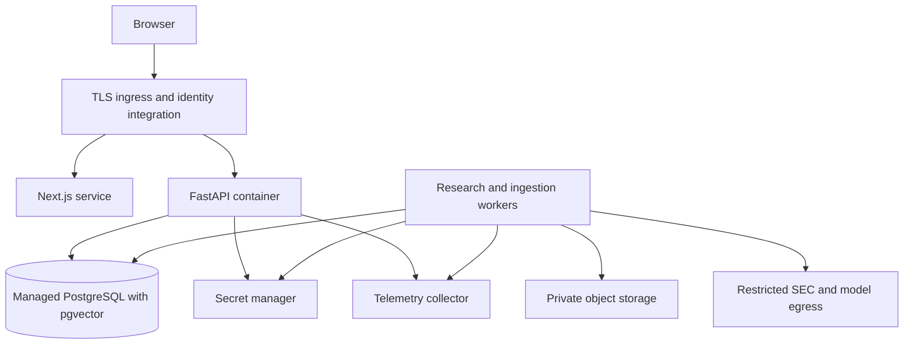

# Deployment and observability architecture

Status: the local Phase 1 foundation, containers, migrations, and CI workflow are implemented; managed deployment remains proposed. See [development](../development.md) for tested commands. [ADR-008](../adr/ADR-008-deployment-security.md) records the local-to-cloud decision.

## Local development

Phase 1 establishes a reproducible `uv` environment, pinned tool versions, PostgreSQL with pgvector through Docker Compose, explicit Alembic migrations, and tested startup/readiness instructions. Prefer running Python tooling on the host environment and infrastructure in Compose; application containers are also built and validated as part of foundation packaging. Bind development services to loopback. A missing Docker daemon requires a supported native PostgreSQL/pgvector fallback or a concrete environment blocker; SQLite does not validate vector/search integration.

Retain dependency caches, virtual environment, source artifacts, and database volumes separately from processes. New cloud tasks may restore filesystem state but must restart services and verify readiness. Use the existing isolated checkout; no worktree is needed. During Phase 1, save tested installation and startup instructions using the cloud environment configuration tools when available. Phase 0 does not install or claim that environment is ready.

Planned runtime configuration names include `APP_ENV`, `DATABASE_URL`, `ARTIFACT_ROOT`, `SEC_USER_AGENT`, `SEC_REQUESTS_PER_SECOND`, `MODEL_PROVIDER`, model/embedding IDs, provider credential bindings, and telemetry settings. Define exact names and validation in Phase 1/4. Never place secret values in examples or documentation. If a cloud environment reserves a variable name, choose a supported nonreserved binding and pass it explicitly to the provider adapter rather than assuming SDK auto-discovery.

Local API readiness validates database connectivity and schema compatibility; research readiness also checks active dataset/index configuration. Provider access is a separately reported dependency check, avoiding a paid generation on every probe. SEC access is required for ingestion, not for querying an already prepared snapshot.

## Managed deployment target

Select one managed container platform, object store, and managed PostgreSQL provider in Phase 7 after checking supported pgvector version, region, data residency, backups, extension privileges, egress, and cost. A practical candidate is a managed container service plus managed PostgreSQL and blob storage; no provider-specific deployment is selected or provisioned in Phase 0.

The API and worker use the same versioned application image with different entry points. Use PostgreSQL job leases and bounded worker concurrency initially. Separate ingestion and research queues/priorities to prevent a large backfill starving user requests. Keep model calls outside database transactions. Scale using measured queue delay, CPU, connection pressure, and latency; use a connection pool with a total connection budget across replicas.

Migrations are an explicit release job, not an operation every replica races to perform at startup. Use backward-compatible expand/contract migrations; restore tests are required before destructive changes. Dataset/index publication uses a version pointer so application rollback does not require deleting new artifacts.

## CI/CD progression

- **Phase 1:** frozen dependency install, lint/type checks, unit tests, PostgreSQL integration tests, migration tests, package/container build checks. No live API secrets needed for the default path.
- **Phases 2–5:** contract fixtures, parser/finance tests, retrieval integration, graph recovery, UI/API contract checks, deterministic end-to-end fixtures. Credentialed smoke checks are opt-in and clearly labeled.
- **Phase 6:** versioned evaluation reports and regression gates with budgeted model calls. Untrusted pull requests cannot access provider/deployment secrets.
- **Phase 7:** trusted CI builds immutable image digests, scans dependencies/images, deploys to staging, runs smoke and migration checks, and releases through an authorized promotion gate. Prefer workload identity/OIDC to long-lived cloud keys.

No automatic production release is implied by creating CI configuration. Record deployed code, image, migration, dataset, and prompt/model versions together.

## Operational telemetry

Structured logs include event, severity, timestamp, request/run/job IDs, component, duration, error code, and safe version metadata. Redact credentials and avoid raw questions, source text, model outputs, and personal data by default. Opt-in debug capture requires access controls and retention limits.

Trace API → queue → graph node → tool → retrieval/database/model calls using OpenTelemetry-compatible propagation. Record model ID, prompt version, token counts, retry count, finish status, and cost estimate with pricing version. Do not record hidden reasoning. Use low-cardinality metric labels; individual run IDs belong in logs/traces, not metric dimensions.

Measure p50/p95 request and end-to-end latency, time-to-first-progress, queue age, throughput, error rate, tool/graph failures, invalid tool attempts, provider throttles, ingestion lag, SEC 403/429 counts, dataset quality/quarantine rate, storage growth, tokens, and cost per task. Define workload-specific SLOs after baseline measurement in Phase 6/7; none have been measured yet.

## Backup, recovery, and retention

Back up PostgreSQL with point-in-time recovery where supported and enable object-store versioning/retention consistent with immutable sources. A backup is not proven until a restore exercise verifies manifests, artifact checksums, evidence resolution, and a representative research run. Proposed initial planning targets: database RPO 24 hours and RTO 4 hours; revise based on cost and requirements before deployment and measure the restore result.

Document recovery from worker termination, lost job leases, database restart, object-store outage, provider outage, corrupted derived indexes, and incompatible checkpoint schemas. Rebuild derived indexes from canonical datasets. Retain source artifacts and manifests referenced by retained reports; garbage collection must check references and retention policy. Minimize and separately expire user requests/checkpoints and debug traces.

## Deployment acceptance

Authentication and tenant/owner isolation, secret management, rate/usage limits, verified TLS, safe error responses, migrations, rollback, backup restore, load tests, and alert routing must pass before shared deployment. A running container or health endpoint alone does not establish production readiness. Record limits and unresolved risks in the deployment runbook.
