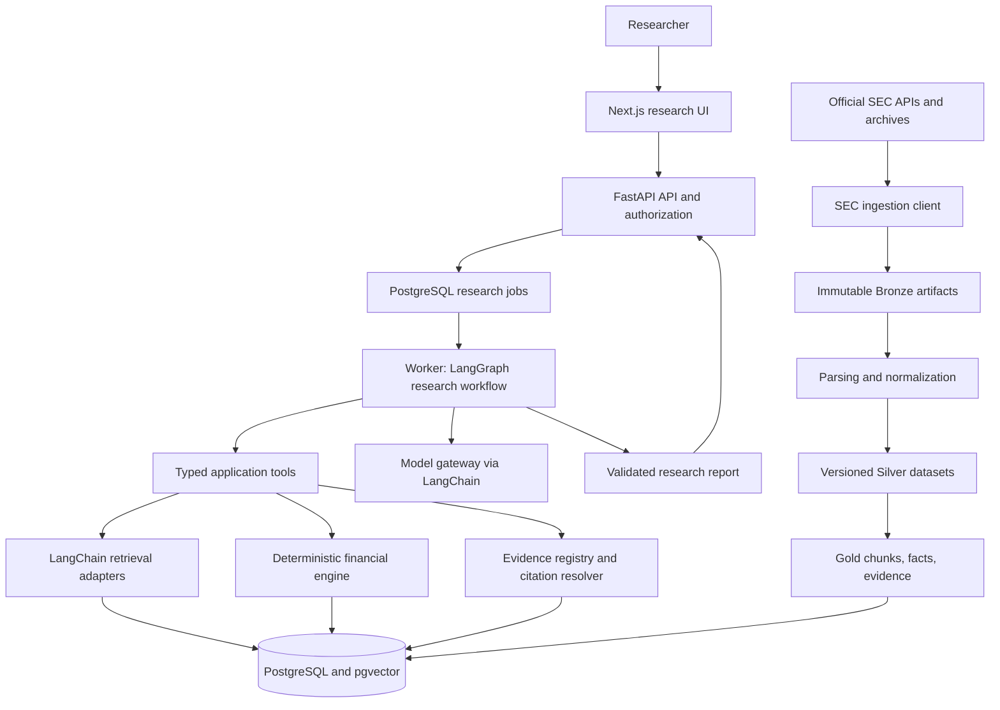

# System overview — architecture 3.1

Status: target design. Phase 1 implements typed configuration, safe errors/logging, the PostgreSQL foundation, migrations, and health endpoints. Research, ingestion, datasets, and UI components remain proposed. See [requirements](../requirements.md), [data architecture](data-architecture.md), and [AI architecture](ai-architecture.md).

## Research flow

Source processing and research execution have separate lifecycles. A research run selects a published Gold snapshot; it cannot silently change to a newer snapshot midway through an answer. Ingestion does not require a model provider. Retrieval and calculations can be tested without external generation.

## Components and dependencies

| Component | Responsibility | Dependencies and boundary |
| --- | --- | --- |
| SEC ingestion | Resolve official source URLs, enforce access policy, download artifacts, record manifests | HTTP adapter and artifact store; never directly calls models |
| Document processing | Parse sections/tables, normalize observations, emit quality events | Immutable artifacts and versioned parser/schema configuration |
| Dataset publisher | Build and validate Gold; publish a complete snapshot atomically | Silver datasets, evidence registry, serving database |
| Retrieval service | Apply filters, search indexes, expand context, resolve citations | Published Gold snapshot, model gateway for embeddings, PostgreSQL |
| Financial service | Select observations, validate comparability, calculate metrics | Canonical financial observations and deterministic policy/formula catalog |
| Research workflow | Plan, invoke bounded tools, reconcile evidence, synthesize, verify | Application services, LangChain adapters, LangGraph checkpoints |
| FastAPI | Validate requests, authenticate/authorize, submit/read/cancel jobs | Application use cases; no financial logic in routes |
| Next.js | Questions, progress, cited report, calculation inspection | Versioned REST contracts; no provider credentials in browser |
| Evaluation harness | Execute frozen cases, score outputs, report regressions | Same application interfaces as production and isolated datasets |
| Operations | Migrations, job recovery, telemetry, retention, backup/restore | Database, object store, secret manager, container platform |

One deployable Python package exposes API and worker entry points. They may run as separate processes for durability and resource isolation; this is not a microservice split. PostgreSQL remains the shared transactional store. Canonical datasets and immutable source objects can rebuild serving projections and retrieval indexes.

## API contract proposal

Routes below are planned. Schemas live in `contracts/`, with an OpenAPI snapshot validated in future contract tests.

| Method and path | Purpose | Key behavior |
| --- | --- | --- |
| `GET /health/live` | Process liveness | No external model or SEC calls |
| `GET /health/ready` | Service readiness | Database reachable, schema compatible; required dataset/index readiness exposed for research mode |
| `GET /v1/companies?query=...` | Company candidates | Stable CIK identity; ambiguous names return candidates |
| `GET /v1/companies/{cik}/filings` | Filing catalog | Pagination, type/date filters, availability metadata |
| `POST /v1/research` | Submit question and constraints | Returns `202`, `run_id`, status path; validated idempotency key scoped to actor and payload |
| `GET /v1/research/{run_id}` | Progress or completed result | Owner/tenant check; sanitized progress, report or structured failure |
| `POST /v1/research/{run_id}/cancel` | Cooperative cancellation | Terminal state is idempotent; stops at safe checkpoints |
| `GET /v1/evidence/{evidence_id}` | Evidence excerpt and provenance | Access check, safe text/table rendering, source URL and locator |

Research input: question (bounded length), optional company hints, filing forms, period constraints, historical cutoff, and report preferences. The server owns allowed budgets, tenant context, dataset selection, provider selection, and network destinations. A client cannot gain privileges by submitting a tool name or tenant ID.

Research output: status, resolved scope, report claims, citations, calculations, warnings, abstention reasons, snapshot/version identifiers, and run metadata. See [AI architecture](ai-architecture.md) for the report structure. API errors use a stable envelope: `code`, safe `message`, `retryable`, `request_id`, and optional field details; never include tracebacks, credentials, or raw provider payloads.

Phase 4 may execute a bounded RAG request in the API process while maintaining this response shape. Phase 5 moves long-running execution to durable jobs and checkpoints. In-process tasks cannot be described as durable or production-ready.

## Interfaces to define before implementation

- `ArtifactStore.put_if_absent(bytes, checksum)` and `read(artifact_id)` ensure content integrity and no overwrite.
- `FinancialFactRepository.find_candidates(scope, cutoff, snapshot)` returns candidates plus source/context metadata, not a silently chosen number.
- `FinancialSelector.select(candidates, policy)` returns selected inputs or an explicit missing/ambiguous/incompatible result.
- `EvidenceSearch.search(query, filters, snapshot)` returns scored evidence identifiers with source metadata.
- `CitationResolver.resolve(evidence_id, snapshot)` returns the recorded source artifact and locator; it never follows model-created URLs.
- `ModelGateway.generate/embeddings` enforces deadlines, usage tracking, typed responses, and provider configuration.
- `ResearchCheckpointStore` and job repositories support leases, cancellation, state versioning, and restart recovery.

## Cross-cutting invariants

Every request, job, dataset build, tool call, and evidence item has a stable correlation identifier. Store the claim → evidence → source and calculation → selected observations → source chains. Database transactions and immutable manifests define publication boundaries. Retries may repeat work but must not expose half-published data or duplicate billable generation unknowingly.

Initial development is local and isolated. Public exposure requires the authentication, authorization, operational, and evaluation gates in [security](security-architecture.md) and [deployment](deployment-architecture.md).
