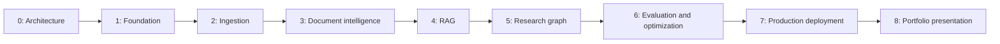

# Implementation roadmap — architecture 3.1

Status: Phase 0 planning and Phase 1 foundation are implemented; see the [Phase 1 review](phase-1-review.md) for evidence and limits. Phases 2–8 remain planned. Each listed work package is a separate assignment with audit → plan → implementation → verification → review → stop. Explicit authorization is required for the next package, even within one phase. A user may explicitly assign a whole phase; keep its packages bounded and report their individual outcomes within that authorized scope.

## Sequence, estimates, and shared definition of done

Evaluation fixtures and security controls begin when their components appear; the later phases consolidate and validate them. Baseline work cannot be deferred to justify implementing optimization first.

Effort estimates assume one experienced full-time engineer, a small curated initial SEC corpus, and timely access to required accounts. They are engineering days, not elapsed delivery promises; annotation, provider access, cloud approval, and unfamiliar filing edge cases may extend them. Planned Phases 1–8 total roughly **73–111 engineer-days**, excluding external waiting and major scope changes.

Every package is done only when its assigned acceptance criteria pass, relevant tests actually execute, contracts/docs/ADRs match behavior, the diff has no secrets or unrelated changes, and the review records failures, skips, limitations, and the next package. Preserve code and data provenance. Stop at the assignment gate; do not automatically begin the next package.

Paths below describe implementation destinations; consult the actual checkout and phase review to determine which exist. Phase 1 creates only the foundation modules needed for its scope.

## Phase 1 — Engineering foundation

**Objective:** reproducible Python development, database services, testing, and CI. **Dependencies:** Phase 0 design review; a supported Python runtime; package registry access; Docker/Compose or a verified native PostgreSQL/pgvector fallback. **Estimate:** 5–8 days.

| Package | Components and proposed files | Ordered implementation steps |
| --- | --- | --- |
| 1A: Package and tooling | `pyproject.toml`, `uv.lock`, `.python-version`, `.gitignore`, `src/sec_research/__init__.py`, `tests/unit/`, developer guide | Verify version compatibility → define minimal package/tool groups → lock dependencies → install cleanly → build package and run meaningful baseline tests |
| 1B: Configuration and persistence | `settings.py`, `contracts/errors.py`, `observability/logging.py`, `adapters/postgres/`, `migrations/`, `compose.yaml`, `.env.example`, Dockerfile | Define config/error/redaction contracts → validate runtime variables → provision pinned database/extension → add explicit migration workflow → validate connectivity and error handling |
| 1C: CI and reusable setup | `.github/workflows/ci.yml`, operational scripts, `docs/development.md`, cloud install/start configuration | Run frozen lint/type/test/build jobs → verify clean install/start/restart → save tested cloud setup/start instructions where available → document required services and blockers |

**Tests:** package build/install/import; configuration validation; safe error/redaction behavior; real database/pgvector connectivity; migration up and supported rollback/reapply; container build; nonzero pytest run; CI-equivalent checks locally. A trivial import alone is insufficient once service configuration exists.

**Acceptance:** another task/developer can reproduce the environment using committed instructions and lockfiles, start required infrastructure, and run baseline tests successfully. No SEC ingestion or research feature is included.

**Key risks:** incompatible framework/interpreter choices, unavailable container daemon or extension, privileged database setup, secret leakage from config errors. Diagnose supported alternatives without weakening integration tests.

**Phase definition of done:** shared criteria plus tested installation/start instructions, pinned tooling, CI configuration, passing baseline evidence, and explicit limitations. **Next gate:** package 2A only after authorization.

## Phase 2 — SEC EDGAR ingestion

**Objective:** reliable, repeatable, traceable source acquisition. **Dependencies:** Phase 1; approved SEC access identity/contact; allowed official SEC endpoints and current fair-access policy verification. **Estimate:** 7–11 days.

| Package | Components and proposed files | Ordered implementation steps |
| --- | --- | --- |
| 2A: SEC transport and contracts | `adapters/sec/client.py`, `contracts/sec.py`, rate-limit/retry policy, SEC fixtures | Inspect official API/policy → define payload and error contracts → implement identifying verified-TLS requests with aggregate limits/deadlines → test retries/redirect restrictions offline → perform a bounded live smoke check when identity is available |
| 2B: Discovery and immutable Bronze | `ingestion/companies.py`, `ingestion/filings.py`, `adapters/storage/local.py`, manifest contracts/migrations | Resolve company/catalog identity → traverse recent and historical submissions → discover 10-K/10-Q documents/amendments → download into immutable checksum storage → commit manifests safely |
| 2C: Company Facts and replay | `ingestion/company_facts.py`, ingestion jobs/CLI, reconciliation utility | Fetch versioned Company Facts → preserve changing source responses → support resumable/idempotent work → reconcile interrupted downloads and orphan objects → document corpus preparation |

**Tests:** User-Agent and rate budgets, 403/429/Retry-After, transient/server failures, redirects, old-submissions pagination, duplicate and amended filings, byte limits, invalid JSON, incomplete writes, checksum mismatch, rerun idempotency, updated JSON preserving previous artifacts. Live access checks are separate from deterministic fixtures.

**Acceptance:** ingest a small documented corpus with filings and Company Facts, resolve every successful manifest to verified bytes, rerun without duplicate logical artifacts, and recover from an interrupted operation. If live SEC access is unavailable, fixture tests may pass but the live-ingestion acceptance remains explicitly outstanding.

**Key risks:** access blocks, policy changes, incomplete historical discovery, mutable endpoints, partial storage writes. Missing SEC identity must be supplied securely; do not fabricate it.

**Phase definition of done:** shared criteria plus a recorded corpus manifest, verified source provenance, compliant live evidence where available, repeatability/recovery proof, and no source overwrites. **Next gate:** package 3A.

## Phase 3 — Document intelligence and AI-ready data

**Objective:** implement ADR-003 from Bronze to versioned, source-resolvable Silver/Gold. **Dependencies:** complete Phase 2 artifacts/manifests and representative reviewed filing fixtures. **Estimate:** 12–18 days.

| Package | Components and proposed files | Ordered implementation steps |
| --- | --- | --- |
| 3A: Document parsing | `processing/html.py`, `sections.py`, `tables.py`, document/block/table contracts | Review varied 10-K/10-Q samples → define locators and parse-quality rules → extract headings/paragraphs/tables/footnotes → validate against source → quarantine unsupported structures |
| 3B: Financial normalization | `processing/xbrl.py`, `domain/periods.py`, `domain/financial_selection.py`, observation schemas and mappings | Preserve source facts → normalize exact values/units/actual intervals → model reporting versions/context uncertainty → implement deterministic eligibility/selection policy → validate historical and fiscal edge cases |
| 3C: Dataset publication and chunks | `processing/datasets.py`, `processing/chunking.py`, evidence registry, Parquet/serving adapters, quality reports | Build versioned Silver → create section/table-aware chunks and Gold facts/catalogs → verify lineage/integrity → publish snapshot atomically → replay from Bronze and compare hashes |

**Tests:** parser diversity, malformed markup, repeated headings, table header/scale/sign handling, section locators, missing contexts, date-only availability, `fy` mismatch, 52/53-week fiscal years, YTD versus standalone quarter, instant versus duration, reporting revisions, unit/currency ambiguity, deterministic IDs, source resolution, interrupted publication and rollback.

**Acceptance:** one frozen dataset can be reproduced from Bronze; research chunks resolve to source; financial observations preserve measurement/reporting semantics and competing versions; quality failures are explicit and block inappropriate publication/serving. No LLM inference is needed to validate the pipeline.

**Key risks:** filing variability, unreliable table extraction, incomplete Company Facts contexts, ambiguous concept equivalence, overaggressive chunking. Raw XBRL context extraction is a separately scoped extension if required to support additional facts; do not invent context to satisfy tests.

**Phase definition of done:** shared criteria plus published dataset manifest, parser/normalizer versions, source-resolution checks, reviewed financial fixtures, quality report, and demonstrated replay. **Next gate:** package 4A.

## Phase 4 — LangChain RAG research engine

**Objective:** cited answers from SEC evidence with measured retrieval quality. **Dependencies:** Phase 3 snapshot; first model/embedding provider selection, secure credential bindings, and cost budget. **Estimate:** 10–15 days.

| Package | Components and proposed files | Ordered implementation steps |
| --- | --- | --- |
| 4A: Dense and keyword baselines | `adapters/models/`, `retrieval/embeddings.py`, `retrieval/search.py`, vector/search migrations, `evaluations/retrieval/` | Verify provider/schema compatibility → version embeddings/index → implement filtered dense search and PostgreSQL full-text baseline → label initial cases → measure retrieval and filter behavior |
| 4B: Grounded research API | `retrieval/citations.py`, `application/research.py`, `api/routes/research.py`, report schemas | Retrieve bounded evidence → generate typed claims → resolve citations → verify source/numeric boundaries → return a research response with explicit partial/abstained states |
| 4C: Evaluated retrieval candidates | `retrieval/fusion.py`, optional `reranking.py`, parent expansion, experiment reports | Compare baselines → evaluate reciprocal rank fusion → test bounded reranking/context expansion → promote only candidates meeting predeclared quality and budget gates |

**Tests:** embedding/index mismatch, filtering/no leakage, empty results, approximate recall under selective filters, citation resolution, nonexistent/irrelevant citation rejection, model timeout/schema errors, representative API research request, offline end-to-end with fake provider, and separately identified live-provider validation.

**Acceptance:** a user can submit a question via the API and obtain an evidence-grounded answer with source-resolvable citations or a justified abstention. Baseline retrieval results are recorded. Extra retrieval stages are evaluated and may be rejected; omission after documented lack of benefit is preferable to unsupported complexity.

**Key risks:** weak corpus labels, provider unavailability, hallucinated support, embedding migration cost, optimization overfit. No public UI or multi-step financial-agent capability is claimed here.

**Phase definition of done:** shared criteria plus a verified functional API request, baseline report, provider/index/prompt version records, citation tests, and documented optimization decisions. **Next gate:** package 5A.

## Phase 5 — LangGraph agentic research engine

**Objective:** multi-step research combining filing evidence and auditable finance. **Dependencies:** Phase 4 RAG services and Phase 3 selection/data contracts. **Estimate:** 12–18 days.

| Package | Components and proposed files | Ordered implementation steps |
| --- | --- | --- |
| 5A: Financial tool contracts | `domain/metrics.py`, `domain/calculations.py`, `application/tools/`, tool/result schemas | Implement and test the eight specified tools → validate concept/period/context eligibility → calculate approved metrics with Decimal → persist input/formula provenance and typed failures |
| 5B: Bounded research graph and jobs | `research/state.py`, `research/graph.py`, `research/nodes/`, `jobs/`, PostgreSQL checkpoint/lease adapters | Define state transitions and budgets → connect planning/routing/evidence/calculation/validation/synthesis → persist jobs/checkpoints → implement cancellation/retries/recovery → verify crash/resume and budget behavior |
| 5C: Research UI and end-to-end flow | `web/` Next.js package/lockfile, API progress/cancel/evidence routes, browser tests | Define typed API client → build question/progress/report views → show citations, calculations, warnings and abstention → validate representative multi-company research and failure flows |

**Tests:** all tool schemas and forbidden inputs; financial edge cases from ADR-006; ambiguous scope; plan validation; graph limits; repeated calls; worker restart/lease races; schema migration rejection; failed provider recovery; cancellation; actor scope in records; API/UI report and calculation inspection. Real-model task evaluation is separate from deterministic graph tests.

**Acceptance:** the reference multi-company scenario produces reproducible calculations and supported narrative or clearly identifies missing/conflicting evidence. Research resumes from durable state after a tested interruption, stays within configured budgets, and exposes progress and evidence through a minimal UI.

**Key risks:** unchecked model plans, incompatible reporting bases, redundant calls, checkpoint version drift, duplicate billable generation, misleading progress/completion states. No additional agents are introduced without evaluation evidence.

**Phase definition of done:** shared criteria plus functional UI/API/worker checks, tool/finance provenance, bounded recovery evidence, initial task-success results, and a documented distinction between local demo and shared production use. **Next gate:** package 6A.

## Phase 6 — AI evaluation and optimization

**Objective:** reproducible benchmark comparisons and justified improvements. **Dependencies:** stable Phase 4/5 baselines, frozen snapshots, annotation effort, provider evaluation budget. **Estimate:** 10–15 days.

| Package | Components and proposed files | Ordered implementation steps |
| --- | --- | --- |
| 6A: Golden datasets and harness | `evaluations/datasets/`, annotation/split manifests, `evaluation/metrics.py`, runner | Freeze case schemas and independent labels → audit leakage → implement tested metrics → calibrate semantic judges against reviewers → reproduce baseline runs |
| 6B: Agent and adversarial regression | `evaluations/agent/`, `evaluations/security/`, CI evaluation jobs | Score task/tool/recovery behavior → test injection/access/budget cases → report slices and hard-gate failures → add bounded regression checks |
| 6C: Controlled optimization | experiment configs, model comparison, optional cache adapter, evaluation reports | Predeclare improvement/budget criteria → compare models/prompts/retrieval settings → measure latency/tokens/cost → test cache correctness if justified → retain only supported improvements |

**Tests:** metric formulas and denominators, empty and no-answer cases, split/manifest integrity, judge disagreement, frozen reruns, finance exactness, injection and unauthorized tools, correct cache keys across actor/snapshot/cutoff/policy, current-run report identity, token/cost accounting.

**Acceptance:** publish reproducible reports comparing the named baseline and final configuration with actual case-level results, confidence/limitations, failure analysis, and latency/cost measurements. Meet calibrated gates or explicitly identify blockers; never relabel targets as measurements.

**Key risks:** annotation cost, leakage, judge bias, overfitting, provider drift, tiny-sample claims, optimization degrading abstention or security. Treat provider changes as new experiments.

**Phase definition of done:** shared criteria plus actual benchmark artifacts, metric verification, regression gates, documented optimization decisions, and versioned cost/latency budgets for deployment testing. **Next gate:** package 7A.

## Phase 7 — Production engineering and cloud deployment

**Objective:** deploy a secure, observable application with tested operational limits. **Dependencies:** Phase 6 quality/security gates; cloud/identity provider and region choice; account access, budget, domain/TLS, retention and workload requirements. **Estimate:** 12–18 days.

| Package | Components and proposed files | Ordered implementation steps |
| --- | --- | --- |
| 7A: Identity and resource controls | `api/auth/`, authorization policies, quota middleware, hardened job config, security tests | Define identity/tenant model → enforce object access → configure secrets/network policies → add per-user/concurrency/token limits → test isolation and abuse paths |
| 7B: Managed infrastructure and delivery | `infra/`, application images, `.github/workflows/deploy.yml`, staging runbook | Verify provider/pgvector capabilities → provision managed database/object storage/container services → configure workload identity → run migrations and staging smoke tests → prepare controlled release/rollback |
| 7C: Operations and recovery | telemetry export, dashboards/alerts, backup/restore and incident runbooks, load-test scenarios | Measure workload/SLOs → exercise provider/worker/database failures → restore backup and resolve evidence → load test → verify rollback/alerts → document limits and release evidence |

**Tests:** identity/session handling, owner/tenant isolation across all paths, CSRF/CORS as applicable, secret redaction/rotation, job durability under scale, resource limits, TLS/egress policies, migration compatibility, actual restore, load at declared concurrency, staging smoke and rollback.

**Acceptance:** deployed application has verified access controls, observability, backup/recovery, CI/CD, rate/usage limits, and measured workload behavior. Shared release requires passing hard security gates and a concrete release review; infrastructure definitions alone are insufficient.

**Key risks:** cloud cost, extension/version constraints, connection exhaustion, credentials/retention errors, untested recovery, migrations affecting checkpoints. Obtain required deployment authorization when the concrete release is prepared; do not expose unauthenticated development mode.

**Phase definition of done:** shared criteria plus deployed-version inventory, functional staging/production evidence as authorized, load/recovery results, alerts and operational runbooks, and honest limits. **Next gate:** package 8A.

## Phase 8 — Portfolio and hiring presentation

**Objective:** an independently reviewable demonstration of applied AI engineering. **Dependencies:** Phase 7 deployable/reviewed application, Phase 6 measured reports, complete operational docs. **Estimate:** 5–8 days.

| Package | Components and proposed files | Ordered implementation steps |
| --- | --- | --- |
| 8A: Research experience polish | `web/` accessibility/error/report refinements, demo cases | Review real research flows → improve clarity/progress/citation/calculation inspection → validate accessibility and responsive behavior → prepare clearly labeled demo data |
| 8B: Reproducible presentation | README update, architecture diagrams, `docs/case-study.md`, benchmark/demo/setup guides | Link measured evidence → document tradeoffs and failure analysis → verify fresh setup and demo → write portfolio/resume claims bounded by actual results |

**Tests:** fresh documented setup, live demonstration with known source scope, navigation/accessibility checks, citation/calculation inspection, documentation links, benchmark reproduction, and evidence audit for every claimed achievement. Protect public demo quotas and private research history.

**Acceptance:** a hiring manager can understand the architecture, run or access the authorized demo, inspect evidence/calculations, reproduce documented measurements, and distinguish completed features from limitations.

**Key risks:** presentation overstating production readiness, stale screenshots/metrics, unreproducible demo data, leaking secrets or user queries. Keep synthetic/demo examples labeled.

**Phase definition of done:** shared criteria plus a reviewed demonstration, accurate README/case study, reproducible setup/results, and verified achievement statements. No automatic expansion beyond the project roadmap.

## Recommended next assignment

Phase 1 packages 1A–1C have been implemented under explicit whole-phase authorization. The next assignment is **2A: SEC transport and contracts**, after Phase 1 review and explicit authorization. No SEC client, download, discovery, or ingestion code is included in the foundation.
